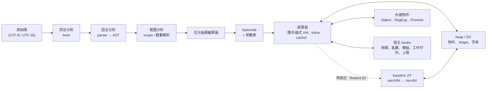

# rujse 計畫

2026-11-26。rujse 是用 Rust 寫的 JavaScript 引擎。這份文件是動手之前的計畫；[§9](#9-要請你決定的事) 是要請你決定的事。

## 1. 兄弟專案現在怎麼跑 JavaScript

| 專案 | 現在的 JS 引擎 | 執行環境 | 痛點 |
|---|---|---|---|
| rubrowser | boa 0.22（`boa_engine`，feature `annex-b`） | 編成 `wasm32-unknown-unknown` 的 `js.wasm`（約 6.6 MB），原生版由 wasmtime 編成機器碼、網頁版由 wasmi 直譯；受 fuel 與 512 MiB 記憶體限制 | 模組大、第一次載入要編譯約 1 秒；遞迴上限要靠 16 MiB 堆疊撐；超過上限的 `RuntimeLimitError` 不能被 `try/catch` 捕捉（瀏覽器是 `RangeError`）；時間與亂數要自己接 |
| rucloud | Node.js（V8） | 每個應用一個 `node host.mjs` 程序 | 需要 Node 22.15+；Worker 程式依賴原生的 `fetch`、串流、`crypto.subtle` |
| ruxos | （要跑 Node） | 取代 Linux 核心 | V8 需要 RWX 的 JIT 記憶體、使用者模式的快取維護、和 Linux 一模一樣的信號框架（[ruxos/doc/plan.md](../../ruxos/doc/plan.md) §1.2） |

rubrowser 用到的 boa API（`src/lang/js.rs`）：`Context`、`NativeFunction`、`register_global_property`、`ObjectInitializer`、`ModuleLoader`、`JsArrayBuffer` / `JsTypedArray`、`PromiseState`、`SimpleJobExecutor`、`RuntimeLimits`、`Clock` / `HostHooks`。這就是 rujse 嵌入 API 最少要涵蓋的範圍。

由此得到幾個設計限制：

* **一定要能編成 wasm 且沒有 JIT 也能跑。** wasm 裡不能產生機器碼，所以直譯器是主角，不是過渡品。
* **核心不依賴作業系統。** 時間、亂數、模組載入、工作佇列都由宿主提供（`no_std` + `alloc`，feature `std` 預設開啟）。
* **資源上限是第一級功能。** 指令預算（中斷檢查）、記憶體上限、呼叫深度，超過時丟出可以捕捉的 `RangeError`／可由宿主終止的錯誤，而不是讓 runtime 壞掉。

## 2. 目標與非目標

### 2.1 目標

* **語言**：ECMAScript 2026（ECMA-262 第 17 版，2026 年 6 月通過）的完整語言與內建物件，含 Annex B（瀏覽器相容語法，rubrowser 需要）。之後每年跟上新版；stage 4 以前的提案不做。
* **符合度以 test262 衡量**：固定一個 test262 commit，排除 `intl402/` 與 `staging/`，以通過率為主要指標；已知失敗的清單提交在 repo（`tests/test262-expectations.txt`），每次測試比對，**新的失敗就是退步**。
* **可嵌入**：一個安全的 Rust API（§5），讓 rubrowser 能把 `js.wasm` 換成 rujse。
* **速度要緊，但排在正確之後**：直譯器追上 QuickJS、明顯快過 boa；之後用 baseline JIT 再往上（§7）。
* **依賴少、授權列得出來**：核心 crate 沒有執行期依賴（§8）。

### 2.2 非目標（1.0 之前）

* **Intl（ECMA-402）**：rubrowser 已在 `prelude.js` 提供自己的 `Intl`；放到 1.0 之後再評估。
* **最佳化 JIT**（像 V8 TurboFan／Maglev 那種推測型、去最佳化的編譯器）：工程量大，1.0 不做。
* **Node.js 相容層**（`require`、`fs`、`process`…）與 Web API（`fetch`、DOM）：那是宿主（rubrowser、未來的 rucloud host）的事，不在引擎裡。
* **取代 rucloud 的 Node**：見 §5.3，只列為 1.0 之後的實驗。
* **多執行緒共享同一個 heap**：一個 `Runtime` 只在一條執行緒上用（和 V8 isolate、QuickJS runtime 相同）；`SharedArrayBuffer`／`Atomics` 照規格做，給 agent（worker）間共享。

## 3. 架構



### 3.1 前端

* **手寫的遞迴下降 parser**，直接處理 ASI、`/` 的 regex／除號歧義、arrow function 與解構的 cover grammar、`async`／`yield`／`await` 的上下文、strict mode、early errors（重複宣告、`break` 標籤等）。錯誤訊息帶行列。
* **延遲編譯**：第一遍只檢查函式本體的語法與 early errors，第一次呼叫時才編成 bytecode（V8 與 QuickJS 都這樣做，影響啟動時間）。
* **範圍分析**決定每個變數放在暫存器（不被閉包捕捉）、環境槽（被捕捉）、還是要動態查找（`with`、非 strict 的直接 `eval`）。

### 3.2 位元組碼與直譯器

* **暫存器式 bytecode 加累加器**（類似 V8 Ignition）：指令短、`dispatch` 次數比純堆疊式少，也比較容易做 baseline JIT。
* **值的表示**：64 位元 NaN-boxing（double、int32、bool、undefined、null、指向 heap 的指標）；在 wasm32 上指標是 32 位元，同樣放得下。
* **物件**：hidden class／shape（屬性名稱→槽位的轉移樹）、陣列元素另存（密集／稀疏兩種）。屬性讀寫、呼叫點用 **inline cache**（單型 → 多型 → 字典）。
* **字串**：Latin-1 與 UTF-16 兩種儲存、rope（串接延遲攤平）、原子化（property key 用 interned 字串比較指標）。語意照規格以 UTF-16 code unit 為單位。
* **例外與 generator**：直譯器的框架存在 heap 上可以暫停與恢復，所以 generator、async function、async generator 不需要原生堆疊的協程。
* **深度遞迴不吃原生堆疊**：JS 呼叫 JS 時直譯器不遞迴呼叫自己（框架放在 VM 自己的堆疊上），只有經過原生函式（`Array.prototype.map` 的回呼、getter、`Proxy` trap）時才遞迴；兩者都計數，超過上限時丟出可捕捉的 `RangeError`。這解決 rubrowser 現在的遞迴問題。

### 3.3 GC

* **精確（precise）、追蹤式、不移動的 mark-sweep**，依大小分級的空閒串列配置。只在配置時（safepoint）觸發。
* **根**：VM 堆疊與框架（VM 自己知道每個槽的型別）、全域物件、內建物件、以及原生程式碼的 `Handle`（handle scope，同 V8／rusty_v8 的做法，生命週期由 Rust 的 lifetime 檢查）。
* `WeakMap`／`WeakSet`／`WeakRef`／`FinalizationRegistry` 用 ephemeron 標記。
* **之後**：增量標記（降低暫停時間）與 generational（nursery 用 bump 配置）列在 M5 之後，視量測結果再做；設計上保留寫入屏障（write barrier）的掛點。
* `unsafe` 集中在 `gc`、`value`、`vm` 三個模組，各自寫清楚不變式；其他模組 `#![forbid(unsafe_code)]`。

### 3.4 內建物件與周邊

* 內建物件以 Rust 實作為主；規格裡用 JS 寫起來比較自然、又不在熱路徑上的少數函式可以用 JS 寫成 self-hosted 程式，編進二進位檔。
* **RegExp**：自己的 backtracking 引擎（Rust 的 `regex` crate 不支援反向參照與 lookbehind），編成自己的 regex bytecode，支援 `u`／`v` 旗標（Unicode 屬性與集合運算）、具名群組、`d` 旗標，有步數上限避免災難性回溯卡死宿主。
* **Unicode 資料**：ID_Start／ID_Continue、大小寫轉換、屬性表，由 `tools/gen-unicode` 從 Unicode Character Database 產生 Rust 表格並提交。
* **數字轉字串**：最短往返（shortest round-trip）演算法自己實作；`toFixed`／`toPrecision`／`toString(radix)` 照規格。
* **Date**：時區與本地時間由宿主 hook 提供（rubrowser 已有 `jiff` 讀主機的 tzdb）；預設 UTC。

### 3.5 JIT

* **只有直譯器的建置一定存在**（wasm、ruxos 早期、需要 W^X 的環境）。
* **baseline JIT**（feature `jit`，M7）：把一個函式的 bytecode 逐條翻成機器碼，沿用直譯器的框架格式與 inline cache，不做推測與去最佳化，所以行為和直譯器完全一致（同一份 test262 在兩種模式下都要通過）。這是 V8 Sparkplug、SpiderMonkey Baseline 的做法，實作量可控。
* **後端**：自己的小型組譯器，**先 aarch64**（iMac M3、ruxos、ruvm `-accel hvf`），再 riscv64，x86_64 看需求。不用 Cranelift（依賴大，而且 baseline JIT 不需要暫存器配置器）。
* **平台細節**：macOS 用 `MAP_JIT` 與 `pthread_jit_write_protect_np` 切換寫／執行；Linux（含 ruxos）用 W^X 的雙重映射或 `mprotect` 切換，加上 aarch64 的 `DC CVAU`／`IC IVAU`、riscv64 的 `fence.i`／`riscv_flush_icache`。和 V8 不同，rujse 的 JIT **不需要信號處理**（邊界檢查用明確比較），對 ruxos 的要求比 V8 少很多。
* **wasm 裡的 JIT**（把熱函式編成 wasm 模組、請宿主 instantiate）理論上可行，但要改 rubrowser 的 ABI，列為 1.0 之後的研究題目。

## 4. Repo 結構

```text
rujse/
  Cargo.toml            # workspace
  src/                  # crate `rujse`：lib（no_std + alloc，feature std/jit）
    lexer/ parser/ ast/ scope/ compiler/ bytecode/
    vm/ gc/ value/ object/ string/
    builtins/ regexp/ unicode/ number/ module/
    jit/                # feature "jit"
    bin/rujse.rs        # CLI：執行檔案、REPL、--dump-bytecode
  tools/
    test262/            # test262 執行器（Rust）
    bench/              # 跑 rujse / boa / QuickJS / node 的效能比較
    gen-unicode/        # 從 UCD 產生表格
    licenses.sh         # 列出所有依賴的授權
  tests/                # 單元與整合測試、test262 已知失敗清單
  test.sh               # cargo test + test262 回歸 + wasm 建置檢查
  doc/                  # 本文件、架構、API、量測結果
```

## 5. 嵌入 API

### 5.1 形狀

```rust
let mut rt = rujse::Runtime::new(rujse::Options {
    max_heap_bytes: 512 << 20,
    max_call_depth: 10_000,
    ..Default::default()
});
rt.set_host(MyHost);                 // impl rujse::Host：now()、random()、load_module()、
                                     // promise_rejection()、interrupt() …
rt.scope(|cx| {
    let print = cx.function("print", 1, |cx, _this, args| {
        println!("{}", args.get(0).to_string(cx)?);
        Ok(cx.undefined())
    });
    cx.global().set(cx, "print", print)?;
    let v = cx.eval(Source::script("1 + 2", "main.js"))?;   // Result<Handle<Value>, Exception>
    cx.run_jobs()?;                                          // microtask
    Ok(())
})?;
```

* `Handle<'s, T>` 綁在 scope 的生命週期上，GC 不會回收；要跨 scope 保存就用 `Persistent<T>`（宿主登記的事件處理函式需要）。
* 例外是 `Exception`（帶 JS 值與 stack），宿主中斷（`interrupt()` 回傳 true、指令預算用完）是不能被 JS 捕捉的 `Termination`，之後 `Runtime` 仍可使用。
* 型別化的包裝：`Object`、`Function`、`Array`、`ArrayBuffer`、`TypedArray`、`Promise`（可讀狀態）、`Module`。
* **C ABI 不在 1.0 範圍**；rubrowser 的 wasm runtime 是 Rust，直接用 Rust API。

### 5.2 rubrowser

M4 時在 rubrowser 加 feature `js-runtime-rujse`，把 `src/lang/js.rs` 改寫成用 rujse，編出另一個 `js.wasm`。和 boa 版並存，用 rubrowser 現有的 JS 測試與 `about:` 範例比較；達到 §7 的目標（正確性不輸 boa、模組更小、啟動更快）之後再請你決定是否換成預設。這些修改在 rubrowser 自己的 commit 裡。

### 5.3 rucloud 與 ruxos（1.0 之後）

* **ruxos**：rujse 不開 JIT 時只需要一般的 `mmap`／`read`／`write`，比 Node 更早能在 ruxos 上跑，可以當 ruxos 的第一個 JS 使用者程式與測試負載；開 JIT 也不需要信號框架。
* **rucloud**：Worker 需要 `fetch`、`Request`／`Response`、`ReadableStream`、`crypto.subtle` 等大量 Web API，Node 已經全部做好。可行的路線是做一個 `rucloud-rujse` host（像 Cloudflare 的 workerd 之於 V8），先跑最簡單的 Worker，用 rucloud 現有的 e2e 測試衡量，但這是獨立的大專案，不在本計畫的里程碑裡。

## 6. 里程碑

每個里程碑都有能自動檢查的結果，並記錄在 `doc/` 裡（test262 通過率、效能表）。

| | 內容 | 可測試的結果 |
|---|---|---|
| **M0 骨架** | workspace、CLI、test262 執行器、bench 工具、`test.sh`、`licenses.sh` | `./test.sh` 會跑；test262 執行器能列出所有測試並回報 0% 與失敗原因分類 |
| **M1 parser** | ES2026 全部語法（含 Annex B）、early errors、模組語法 | test262 的 parse 階段（所有 `negative: phase: parse` 測試要丟出 SyntaxError，其餘要能解析）≥ 99%；fuzz 不 panic |
| **M2 核心 VM** | bytecode 編譯器、直譯器、shape、閉包、例外、`Object`／`Function`／`Array`／`Error`／`String`／`Number`／`Boolean`／`Math`／`JSON`；精確 GC | test262 `language/` ≥ 70%；能跑 V8 benchmark 的 Richards 與 DeltaBlue |
| **M3 完整內建** | Symbol、iterator、generator、async、Promise、Proxy／Reflect、Map／Set／Weak*、TypedArray／ArrayBuffer／SharedArrayBuffer／Atomics、RegExp 引擎、Date、BigInt、模組（含動態 `import()`、top-level await） | test262（排除 intl402／staging）≥ 90%；整套 V8 benchmark 能跑 |
| **M4 嵌入與 wasm** | `no_std` + `alloc` 建置、Host hooks、資源上限、`Handle`／`Persistent` API、文件 | `wasm32-unknown-unknown` 建置通過；rubrowser 的 `js-runtime-rujse` 版通過 rubrowser 現有的 JS 測試；無窮迴圈與深遞迴都能停下並恢復 |
| **M5 直譯器效能** | inline cache、rope、Latin-1 字串、陣列快路徑、延遲編譯、GC 調校 | §7 的直譯器目標 |
| **M6 符合度** | 補齊剩下的失敗、差分測試（和 node 比較輸出）、fuzz（parser、RegExp、VM） | test262 ≥ 97%；fuzz 連續 24 小時沒有 crash |
| **M7 baseline JIT** | aarch64（macOS、Linux）、再 riscv64 | 開 JIT 時 test262 結果與直譯器完全相同；§7 的 JIT 目標 |
| **1.0** | API 穩定、`doc/` 完整 | 語意化版本承諾 |

## 7. 效能目標

### 7.1 怎麼量

* **基準程式**：V8 Benchmark Suite v7（Richards、DeltaBlue、Crypto、RayTrace、EarleyBoyer、RegExp、Splay、NavierStokes；BSD 授權，boa 與 QuickJS 都用它）的分數取幾何平均；另外量**啟動時間**（`hello world` 從建立 runtime 到結束）、**峰值記憶體**、**wasm 模組大小**。
* **對手**：boa 0.22（`boa_cli`，和 rubrowser 同版）、QuickJS（Bellard 版的最新 release）；node 只當參考上限，不當目標。
* **兩種環境**：原生（iMac M3，aarch64 macOS）與 wasm（wasmtime 執行，就是 rubrowser 實際的環境）。boa 與 rujse 都編成 wasm 比；QuickJS 的 wasm 版本若不易建置就只比原生。
* `tools/bench` 產生表格寫進 `doc/bench.md`，記錄機器、版本、commit。

### 7.2 目標

| 指標 | M5（只有直譯器） | M7（baseline JIT，原生） |
|---|---|---|
| V8 bench v7 幾何平均 vs boa 0.22 | ≥ 3× | — |
| V8 bench v7 幾何平均 vs QuickJS | ≥ 1.0×（持平或更快） | ≥ 2× |
| 啟動時間（原生） | ≤ QuickJS 的 2 倍、≤ 5 ms | 同左 |
| `js.wasm` 大小（含 rubrowser 的 prelude） | ≤ 3 MB（boa 版 6.6 MB） | 不適用（wasm 不開 JIT） |
| 峰值記憶體（Splay） | ≤ boa | ≤ boa |

這些倍數是依 QuickJS 與 boa 的已知設計差異（QuickJS 是精簡的堆疊式直譯器、沒有 inline cache；boa 以正確性為主）估的起點，M2 完成第一次量測後會修正並記在 `doc/bench.md`。

## 8. 授權與依賴

* **rujse 本身：MIT**（repo 已有的 `LICENSE`）。
* **核心 crate 沒有執行期依賴。** regex、數字格式化、Unicode 表格都自己做；這也讓 wasm 模組小、`no_std` 容易。
* 開發工具（測試、fuzz、bench）的依賴照常使用，每個都要有列得出來的授權，`tools/licenses.sh` 從 `cargo tree` 列出並寫進 `doc/licenses.md`（和 rucloud、ruwebos、ruxos 一樣）。
* **外部資料**（都需要你同意才下載，屆時會說明檔案、來源與大小）：
  * test262（BSD-3-Clause，`github.com/tc39/test262`）：下載到 `target/` 或 `.gitignore` 的資料夾，不提交；只提交固定的 commit hash 與已知失敗清單。
  * Unicode Character Database（Unicode License v3）：只提交產生出來的表格，附上授權聲明。
  * V8 Benchmark Suite v7（BSD-3-Clause）：bench 用，不提交或附授權提交。
  * QuickJS 原始碼（MIT）與 `boa_cli`（MIT/Unlicense）：只為了量測，在本機建置，不進 repo。

## 9. 要請你決定的事

1. **ECMAScript 版本**：建議以 **ES2026（現行版）+ Annex B** 為目標，test262 固定 commit。
2. **Intl（ECMA-402）**：建議 **1.0 不做**，rubrowser 繼續用 prelude 裡的 Intl。
3. **JIT**：README 寫了「JIT」。建議**先把直譯器做到追上 QuickJS（M5），再做 baseline JIT（M7，aarch64 先、riscv64 後）**；最佳化 JIT 不在 1.0。wasm 版永遠只有直譯器。
4. **依賴**：建議**核心零執行期依賴**（自己寫 regex、數字格式化、Unicode 表格），開發工具可用依賴。
5. **GC**：建議先做**精確、不移動的 mark-sweep**，量測後再決定是否做增量或 generational。
6. **rubrowser 的切換**：建議 M4 時**並存**（feature `js-runtime-rujse`），通過 rubrowser 測試且達到效能目標後，再請你決定是否改成預設。
7. **rucloud**：建議 **1.0 不碰**，Worker 繼續跑在 Node 上；rucloud-rujse host 是 1.0 之後的獨立計畫。
8. **下載**：M0 需要 test262；M2 需要 V8 benchmark v7、QuickJS 原始碼與 `boa_cli`；M3 需要 UCD。每次下載前會再徵求同意並說明大小。
