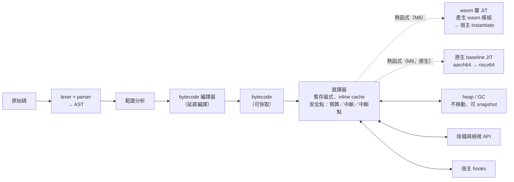

# rujse 計畫

2026-11-26。rujse 是用 Rust 寫的 JavaScript 引擎，**主要目的是取代 rubrowser 裡的 boa**，解決 boa 在 rubrowser 實際碰到的缺陷（§1）。這份文件是動手之前的計畫；[§11](#11-要請你決定的事) 是要請你決定的事。

## 1. 為什麼要做：boa 在 rubrowser 的缺陷

rubrowser 只執行 WebAssembly。JS 的做法是把 boa 0.22 編成 `js.wasm`（約 6.6 MB），原生版由 wasmtime（Cranelift）編成機器碼，網頁版由 wasmi 直譯，受 fuel 與 512 MiB 記憶體限制（[rubrowser/doc/javascript.md](../../rubrowser/doc/javascript.md)）。下表是在 rubrowser 實際碰到或量到的問題，以及 rujse 的對策。**優先順序：1（速度）> 4（可中斷）> 6、7（除錯與物件檢視）> 8（零拷貝）> 其餘。**

| # | boa 的缺陷（實測） | rujse 的對策 | 里程碑 |
|---|---|---|---|
| 1 | **執行慢**：`for (…) x += k` 每圈約 2,300 條 wasm 指令（30 萬圈 6.9 億條、78 ms）；直譯器再編成 wasm，等於直譯兩層 | 為 wasm 設計的快速直譯器（§3.2）；再加 **wasm 層 JIT**：把熱函式編成 wasm 模組交給 wasmtime 編成機器碼，消掉第二層直譯（§3.5） | M5、M8 |
| 2 | **啟動貴**：每頁跑 `prelude.js`（約 4,000 行）4.4 億條指令、49 ms；6.6 MB 的 `js.wasm` 讓 wasmtime 每個行程編譯約 1 秒 | 延遲編譯、快速 parser；**bytecode cache** 與 **heap snapshot**（prelude 跑完的狀態直接載入）；核心零依賴讓模組 ≤ 3 MB | M4、M5 |
| 3 | 超過遞迴上限丟出 `RuntimeLimitError`，`try/catch` 接不到；預設只有 512 層 | JS 呼叫 JS 不吃原生堆疊；超過上限丟出**標準 `RangeError`** | M2 |
| 4 | **無法乾淨中斷**：只能靠 wasm fuel trap，之後 `Context` 可能壞掉，整頁 JS 停用 | 引擎內建**指令預算與中斷旗標**，在安全點停下，回傳不能被 JS 捕捉的 `Termination`，之後 runtime 照常可用 | M2 |
| 5 | `Intl` 只有 en-US（加上自己補的 zh-TW、sv、en-CA 日期） | ECMA-402 實作，CLDR 資料做成**可選的資料檔**，不撐大 `js.wasm` | M10 |
| 6 | **沒有除錯 API**：Sources 不能下中斷點，做不出 CDP `Debugger` | 中斷點、逐步、呼叫堆疊、每層 scope 的變數（§5.3） | M6 |
| 7 | **沒有物件檢視 API**：沒有 `objectId`／`Runtime.getProperties`，Console 不能展開物件 | 穩定的 object handle、列屬性（含 getter，不觸發）、內部狀態（Promise、Map/Set、函式位置、Proxy…）（§5.4） | M6 |
| 8 | `ArrayBuffer` 與宿主之間只能整段複製，上傳 100 MB 檔案時記憶體有好幾份 | **external backing store**（宿主的記憶體直接當 `ArrayBuffer`）與借用內部 slice；GC 不移動物件，指標穩定 | M4 |
| 9 | 字串跨邊界都要 UTF-16 ↔ UTF-8 整份轉換；單獨 surrogate 要用 `_escaped`／`_lossy` | 字串內部有 **Latin-1（含 ASCII 旗標）** 與 UTF-16 兩種；ASCII 字串零拷貝取得 `&str`；明確的 `to_utf8_lossy`／`to_wtf8`；external string | M4 |
| 10 | 模組載入只能同步：要先抓齊整個 import 圖（最多 400 個）；動態 `import()` 只能用寫死的字串 | 照規格的**非同步載入**（`HostLoadImportedModule` → 宿主之後呼叫 `finish_loading`），可以中途暫停、等宿主回報；任意 `import(expr)` | M3 |
| 11 | 呼叫期間不能借出 `Context`，每次都從 thread-local 拿出放回（`with_context`） | API 原生支援**安全重入**：原生函式拿到 `&mut Cx`，可以再呼叫 JS；錯誤與中斷都用 `Result` 傳回，不靠 panic 或 trap | M4 |

由此得到幾個總原則：

* **rubrowser 是第一個也是最重要的宿主**，每個里程碑都用 rubrowser 實際的環境（`wasm32-unknown-unknown` 在 wasmtime 上跑）量測。
* **衡量速度的單位是 wasm 指令數**（和 rubrowser 的 fuel 相同），不只是原生的秒數。
* **核心不依賴作業系統**（`no_std` + `alloc`，feature `std` 預設開啟），時間、亂數、模組、工作佇列由宿主提供。
* **資源上限、中斷、除錯、檢視是第一級功能**，從 M2 起就在直譯器的設計裡，不是事後補上。

## 2. 其他兄弟專案

| 專案 | 現在 | 和 rujse 的關係 |
|---|---|---|
| rucloud | Worker 跑在 Node.js（V8）上 | Worker 依賴大量 Web API，Node 都有；1.0 不換，見 §6.2 |
| ruxos | 要跑 Node，所以要 RWX JIT 記憶體、Linux 一模一樣的信號框架 | rujse 不開原生 JIT 時只要一般 `mmap`；開了也不用信號；可當 ruxos 早期的 JS 負載 |

## 3. 架構



### 3.1 前端

* **手寫遞迴下降 parser**：ASI、`/` 的歧義、arrow function 與解構的 cover grammar、`async`／`yield`／`await` 上下文、strict mode、early errors，錯誤帶行列。
* **延遲編譯**：第一遍只檢查函式本體語法，第一次呼叫才編成 bytecode。prelude 裡大部分函式在載入時不會被呼叫，這直接降低缺陷 2 的成本。
* **範圍分析**：變數放在暫存器（不被捕捉）、環境槽（被閉包捕捉）或要動態查找（`with`、直接 `eval`）。除錯器需要的變數名稱表與原始碼位置表也在這一步產生（§5.3）。

### 3.2 直譯器（針對 wasm 設計）

boa 每圈 2,300 條 wasm 指令，主要浪費在一般化的值處理、配置與間接呼叫。rujse 的直譯器從一開始就以「編成 wasm 之後的指令數」來設計：

* **暫存器式 bytecode 加累加器**（類似 V8 Ignition）：一個 `x += k` 是 1～2 條 bytecode，不是好幾次堆疊推彈。
* **值**：64 位元 NaN-boxing；int32 的加減比較走快路徑（檢查 tag、溢位就轉 double），不配置、不呼叫函式。
* **dispatch**：一個大 `match` 迴圈，熱的指令狀態（`pc`、暫存器基底、累加器）放在區域變數，讓 Cranelift 放進暫存器。wasm 沒有 computed goto，所以重點是每條 bytecode 做的事要少。
* **物件**：shape（hidden class）加 **inline cache**（單型 → 多型 → 字典），陣列元素另存（密集／稀疏）。
* **字串**：Latin-1 與 UTF-16 兩種儲存（Latin-1 帶「全是 ASCII」旗標）、rope、interned property key。
* **JS 呼叫 JS 不遞迴原生函式**：框架在 VM 自己的堆疊上；generator／async 的框架存在 heap，可暫停恢復。只有經過原生函式（`map` 的回呼、getter、Proxy trap）才吃原生堆疊；兩種深度都計數，超過就丟 `RangeError`（缺陷 3）。
* **安全點**：每個函式進入點與迴圈的回跳邊各有一個檢查：一個計數器減一，歸零時才看「預算用完？中斷旗標？有中斷點？」。平常的成本只有一次減法與分支（缺陷 4、6）。

### 3.3 GC

* **精確、追蹤式、不移動的 mark-sweep**，分大小等級的空閒串列，只在配置時觸發。**不移動**讓 `ArrayBuffer` 的指標、借出的 slice 與宿主持有的 handle 都穩定（缺陷 7、8）。
* 根：VM 堆疊與框架、全域與內建物件、`Handle`（scope 內）、`Persistent`（宿主長期持有，例如事件處理函式、CDP 的 `objectId`）。
* `WeakMap`／`WeakRef`／`FinalizationRegistry` 用 ephemeron。
* heap 以分頁組成、頁內用相對位移，讓 **heap snapshot** 可以序列化與重新定位（§3.6）。
* 增量與 generational 是 M5 量測後再決定；保留 write barrier 的掛點。
* `unsafe` 集中在 `gc`、`value`、`vm`，各寫明不變式；其他模組 `#![forbid(unsafe_code)]`。

### 3.4 內建物件

* 以 Rust 實作；少數不在熱路徑、用 JS 寫比較自然的函式 self-host。
* **RegExp**：自己的 backtracking 引擎（反向參照、lookbehind、`u`／`v` 旗標、具名群組、`d` 旗標），有步數上限並參與安全點（不會卡死宿主）。
* **Unicode 表格**由 `tools/gen-unicode` 從 UCD 產生並提交。
* **數字轉字串**：最短往返演算法自己實作。
* **Date**：本地時間與時區由宿主 hook 提供（rubrowser 已有 `jiff`）。

### 3.5 兩個階段：A 引擎編成 wasm，B 把 JS 編成 wasm

「編成 wasm」有兩種意思，效果差很多：

* **A：引擎本身編成 wasm**（boa 現在就是這樣）。這一步本身不會變快：wasmtime 編出的機器碼大約只比原生慢 1.2～2 倍（一般經驗值，未在 rubrowser 實測）。慢的主因是 boa 的直譯器每圈要約 2,300 條 wasm 指令，而設計良好的直譯器估計在幾十到一兩百條（估計，未實測）。所以**光把直譯器做好就可能快一個數量級**。A 也是對的架構：rubrowser 的沙箱（fuel、512 MiB 上限、能停掉卡住的腳本）與網頁版共用同一個 `js.wasm`，都建立在「引擎是 wasm」上。**M0～M7 都走 A**，直譯器效率的重點見 §3.2。
* **B：rujse 把網頁的 JS 編成 wasm**（拿 wasm 當 JIT 的輸出）。這才是第二次大幅加速，排在 **M8**。rubrowser 的 JS 跑在 wasm 沙箱裡，原生機器碼的 JIT 對它沒有用。

**B 的做法（M8）**：熱函式的 bytecode 翻成一個小 wasm 模組，import `js.wasm` 的 memory 與 function table（wasm 支援這種連結），直接操作同一個 JS heap；經由新的 rubrowser import（例如 `rb_compile_module(ptr, len) -> table_index`）交給宿主編譯與連結，因為在 wasm 裡跑的引擎無法自己產生並執行新模組。前提與限制：

* **分層執行**：先直譯，函式變熱（呼叫次數、迴圈回跳次數超過門檻）才編譯；Cranelift 每次編譯都要時間，全部預先編譯會拖慢頁面載入。編譯可以批次（一次送好幾個函式）以攤平成本。
* **動態語意仍靠 runtime**：型別檢查、shape、inline cache、GC 都沿用直譯器的資料結構與框架格式，產生的 wasm 只是把 dispatch 與快路徑攤開；不做推測與去最佳化，所以行為和直譯器完全一致。wasmtime 支援 Wasm GC，有機會借用，但 rujse 的 heap 已在線性記憶體裡，M8 開始時再評估。
* **網頁版受益有限**：網頁版用 wasmi 直譯 wasm，B 在那裡幫助不大；除非網頁版改成把產生的模組交給外層瀏覽器的 `WebAssembly.instantiate`，列為 M8 的選項。
* **相關研究**：Bytecode Alliance 用 partial evaluation（weval）把在 wasm 裡跑的 SpiderMonkey 直譯器預先特化成 wasm，據報可快幾倍（細節與數字以原始資料為準）。M8 開始前會讀原始資料，和「直接產生 wasm」比較後再定案。
* B 需要改 rubrowser 的 ABI（在 rubrowser 自己的 commit）。

**介面先留好**：不論 A 或 B 都需要的介面（可中斷 #4、除錯 #6、物件檢視 #7、零拷貝 #8）在 M2 就定好 API 的形狀與直譯器裡的掛點（安全點、位置表、變數名稱表、不移動的 heap），之後的里程碑才填滿實作，不會因為加 JIT 而改介面。
* **原生 baseline JIT（M9）**：給 CLI、ruxos、未來的 rucloud host 用。自己的小組譯器，aarch64 先（macOS `MAP_JIT` + `pthread_jit_write_protect_np`；Linux／ruxos 用 W^X 切換加 `DC CVAU`／`IC IVAU`），再 riscv64（`fence.i`）。邊界用明確比較，不靠信號。
* 兩種 JIT 共用同一個「bytecode → 低階 IR」前段，只有最後產生 wasm 或機器碼不同。
* 最佳化 JIT（推測、去最佳化）不在 1.0。

### 3.6 啟動：bytecode cache 與 heap snapshot

* **bytecode cache（M4）**：把一段腳本編好的 bytecode 序列化（含版本與原始碼 hash），下次直接載入、跳過 parse 與編譯。rubrowser 可以在建置時把 `prelude.js` 的 cache 一起編進 `js.wasm`。
* **heap snapshot（M5）**：建立 runtime、跑完 prelude 之後把整個 heap 存成映像；每個新頁面直接從映像開始，連 prelude 的頂層程式都不用跑。目標是每頁的 JS 初始化從 4.4 億條指令降到 ≤ 1,000 萬條。
* `js.wasm` 變小（≤ 3 MB）讓 wasmtime 編譯更快；rubrowser 也可以把 wasmtime 編好的模組快取在磁碟上（rubrowser 那邊的工作，不在 rujse）。

## 4. 目標與非目標

### 4.1 目標

* **語言**：ECMAScript 2026（第 17 版）完整語言與內建物件，含 Annex B；之後每年跟上，stage 4 前的提案不做。
* **符合度**：test262 固定 commit，排除 `staging/`（`intl402/` 在 M10 前另計），已知失敗清單提交在 `tests/test262-expectations.txt`，新失敗即退步。
* **rubrowser 的 11 項缺陷全部解決**（§1）。
* **依賴少、授權列得出來**：核心零執行期依賴（§9）。

### 4.2 非目標（1.0 之前）

* 最佳化 JIT。
* Node.js 相容層與 Web API（`fetch`、DOM 等由宿主提供，rubrowser 的 `prelude.js` 繼續負責）。
* 取代 rucloud 的 Node。
* 多執行緒共用同一個 heap（`SharedArrayBuffer`／`Atomics` 照規格支援 agent 間共享）。

## 5. 嵌入 API

### 5.1 基本形狀與重入（缺陷 4、11）

```rust
let mut rt = rujse::Runtime::new(rujse::Options {
    max_heap_bytes: 512 << 20,
    max_call_depth: 10_000,
    ..Default::default()
});
rt.set_host(MyHost);   // impl rujse::Host：now、random、load_module、
                       // promise_rejection、on_debugger_pause …
let print = rt.function("print", 1, |cx, _this, args| {
    let s = args.get(0).to_string(cx)?;
    host_log(s.as_str_if_ascii().unwrap_or(&s.to_utf8_lossy()));
    // 原生函式裡可以再呼叫 JS：cx.call(f, this, &[…])?
    Ok(Value::UNDEFINED)
});
rt.global().set(&mut rt, "print", print)?;

rt.set_budget(Some(30_000_000));            // 指令預算（引擎自己的 tick）
match rt.eval(Source::script(src, "page.js")) {
    Ok(v) => { /* … */ }
    Err(Error::Exception(e)) => { /* JS 例外，含 stack */ }
    Err(Error::Terminated) => { /* 預算用完或宿主中斷；rt 仍可用 */ }
}
rt.run_jobs()?;                               // microtask
```

* `Runtime` 由宿主直接擁有（不放 thread-local、不需要借出），原生函式拿到 `&mut Cx`。
* `Handle<'s, T>` 綁在 scope 生命週期；`Persistent<T>` 跨呼叫保存。
* 中斷：`rt.interrupt_handle()` 回傳可在別的執行緒設定的旗標（原生宿主）；在 wasm 裡由預算觸發。被中斷時整個 JS 堆疊展開到最外層、`finally` 不執行（和瀏覽器停止腳本相同），heap 保持一致。
* rubrowser 仍保留 wasm fuel 當最後防線，但設得比引擎預算寬，正常情況不會觸發。

### 5.2 二進位資料與字串（缺陷 8、9）

```rust
// 宿主的記憶體直接當 ArrayBuffer，不複製；GC 回收時呼叫 drop
let buf = rt.array_buffer_external(Box::<[u8]>::from(bytes));
// 借用內部資料（在下一次可能執行 JS 的呼叫前有效，由 lifetime 保證）
let data: &[u8] = buf.as_slice(&rt)?;       // detached 時回 Err
// 字串
let s = rt.string_from_utf8(text);          // ASCII 直接存成 Latin-1，不轉換
s.as_str_if_ascii();                        // Option<&str>，零拷貝
s.to_utf8_lossy(); s.to_wtf8();             // 單獨 surrogate 的兩種明確處理
rt.string_external(Box::<str>::from(big));  // 大字串由宿主持有
```

### 5.3 除錯 API（缺陷 6）

* bytecode 帶原始碼位置表與變數名稱表；每個 script 有穩定的 `ScriptId` 與 URL。
* `Debugger` 介面：`set_breakpoint(script, line, column, condition)`、`pause_on_exceptions`、`step_into／over／out`、`pause()`。
* 停下時呼叫宿主的 `on_debugger_pause(&mut PausedCx)`：可以列出呼叫堆疊（函式名、位置、`this`）、每層的 scope 鏈與變數、在某一層 `evaluate`。宿主在這個回呼裡處理 CDP 訊息，回傳 resume／step 指令（巢狀訊息迴圈，和 Chrome 相同）。
* 對照 CDP：`Debugger.enable`／`scriptParsed`／`setBreakpointByUrl`／`paused`／`resume`／`stepOver`／`evaluateOnCallFrame`／`getScriptSource`。CDP 的 JSON 轉換在 rubrowser 的 `cdp.rs` 做，rujse 只提供 Rust API。

### 5.4 物件檢視 API（缺陷 7）

* `Inspector`：把值登記成 `RemoteId`（內部是 `Persistent`，以物件群組釋放，對應 CDP `objectGroup`／`releaseObjectGroup`）。
* `own_properties(id, accessor_only, …)`：回傳屬性描述（`value` 或 `get`／`set`，**不呼叫 getter**），可選擇沿原型鏈。
* `internal_properties(id)`：`[[PromiseState]]`／`[[PromiseResult]]`、Map／Set 的 entries、`[[FunctionLocation]]`（script 與行列）、`[[Scopes]]`、`[[BoundTargetFunction]]`、Proxy 的 target／handler、generator 狀態、`[[PrimitiveValue]]`、TypedArray 的 buffer。
* `preview(id)`：給 Console 一行摘要用（類別名、前幾個屬性）。
* 對照 CDP：`Runtime.evaluate` 回傳 `objectId`、`Runtime.getProperties`、`Runtime.callFunctionOn`、`Runtime.releaseObject(Group)`。

### 5.5 模組（缺陷 10）

```rust
impl Host for MyHost {
    fn load_module(&mut self, req: ModuleRequest) {
        // 不必立刻回答：記下 req.token()，開始下載，回到事件迴圈
    }
}
// 之後內容抓到了：
rt.finish_loading(token, Ok(Source::module(src, url)));   // 或 Err(錯誤)
rt.run_jobs()?;
```

規格的 `HostLoadImportedModule` 本來就是非同步的；rujse 照它實作，所以 import 圖可以邊抓邊連結，`import(expr)` 接受任何運算式，import map 由宿主在解析 specifier 時套用。

### 5.6 rubrowser 的導入

M4 時在 rubrowser 加 feature `js-runtime-rujse`，把 `src/lang/js.rs` 改寫成用 rujse，和 boa 版並存。用 rubrowser 現有的 JS 測試、`about:` 範例與 Performance 面板（fuel）比較；達到 §8 的目標後請你決定是否換成預設。M6 時接上 CDP 的 `Debugger` 與 `Runtime.getProperties`。這些修改都在 rubrowser 自己的 commit 裡。

## 6. 其他宿主（1.0 之後）

### 6.1 ruxos

rujse 的 CLI（只有直譯器，或開原生 JIT）可以當 ruxos 的第一個 JS 使用者程式與測試負載，需求只有一般的 `mmap`／`read`／`write`。

### 6.2 rucloud

Worker 需要 `fetch`、串流、`crypto.subtle` 等大量 Web API，Node 都已具備。可能的路線是 `rucloud-rujse` host（類似 workerd 之於 V8），用 rucloud 現有 e2e 測試衡量；這是獨立的大專案，不在本計畫的里程碑裡。

## 7. Repo 結構

```text
rujse/
  Cargo.toml            # workspace
  src/                  # crate `rujse`：lib（no_std + alloc；feature std、jit-wasm、jit-native、intl）
    lexer/ parser/ ast/ scope/ compiler/ bytecode/
    vm/ gc/ value/ object/ string/ snapshot/
    builtins/ regexp/ unicode/ number/ module/
    debug/ inspect/
    jit/                # 共用 IR、wasm 與原生後端
    bin/rujse.rs        # CLI：執行檔案、REPL、--dump-bytecode
  tools/
    test262/            # test262 執行器
    wasmbench/          # 在 wasmtime 裡以 fuel 計數，量 rujse 與 boa 的 wasm 指令數
    bench/              # 原生 rujse / boa / QuickJS / node 比較
    gen-unicode/        # 從 UCD 產生表格
    licenses.sh
  tests/                # 單元與整合測試、test262 已知失敗清單
  test.sh               # cargo test + test262 回歸 + wasm 建置與 wasmbench
  doc/
```

## 8. 效能目標

### 8.1 怎麼量

* **主要：wasm 指令數**。`tools/wasmbench` 把 rujse 與 boa 0.22 都編成 `wasm32-unknown-unknown`，用 wasmtime 的 fuel 計數執行同一批程式，和 rubrowser 的 Performance 面板同一個單位。項目：
  * 微基準：§1 的 `x += k` 迴圈、屬性讀寫、函式呼叫、閉包、字串串接、陣列 push／索引。
  * prelude 初始化：用 rubrowser 現在的 `prelude.js`（跑完頂層程式，不含 DOM 呼叫）。
  * V8 Benchmark Suite v7（Richards、DeltaBlue、Crypto、RayTrace、EarleyBoyer、RegExp、Splay、NavierStokes；BSD），取幾何平均。
* **次要：原生時間**。`tools/bench` 在 iMac M3 原生比較 rujse、boa 0.22（`boa_cli`）、QuickJS（Bellard 最新 release），node 只當參考。
* 另量 `js.wasm` 大小、wasmtime 編譯時間、峰值記憶體。結果寫進 `doc/bench.md`，記錄機器、版本、commit。

### 8.2 目標

| 指標 | boa 0.22（實測／待測） | M5（直譯器 + snapshot） | M8（wasm 層 JIT） |
|---|---|---|---|
| `x += k` 每圈 wasm 指令（rubrowser Performance 面板可直接量） | ≈ 2,300 | ≤ 230（1/10 以下），力求 ≤ 150 | ≤ 20 |
| 每頁 prelude 初始化 | 4.4 億條、49 ms | ≤ 1,000 萬條（snapshot） | 同左 |
| V8 bench v7 幾何平均（wasm） | 基準 | ≥ boa 的 5× | ≥ boa 的 20× |
| V8 bench v7（原生，對 QuickJS） | — | ≥ 1.0× | —（M9 原生 JIT：≥ 2×） |
| `js.wasm` 大小 | 6.6 MB | ≤ 3 MB | ≤ 3.5 MB |
| wasmtime 編譯 `js.wasm` | ≈ 1 s | ≤ 0.4 s | ≤ 0.5 s |
| 峰值記憶體（Splay） | 基準 | ≤ boa | ≤ boa |

這些數字是依設計差異估的起點；M0 的 `wasmbench` 會先把 boa 的整欄量出來，M2 第一次量 rujse 後修正。

## 9. 授權與依賴

* **rujse：MIT**（repo 已有的 `LICENSE`）。
* **核心 crate 零執行期依賴**：regex、數字格式化、Unicode 表格自己做，`js.wasm` 才能小。
* 開發工具可以有依賴（例如 `tools/wasmbench` 用 wasmtime，Apache-2.0 WITH LLVM-exception，和 rubrowser 同一套），`tools/licenses.sh` 列出所有授權寫進 `doc/licenses.md`。
* **外部資料**（都會先徵求你同意，屆時說明檔案、來源與大小）：
  * test262（BSD-3-Clause）：放在 `.gitignore` 的資料夾，只提交 commit hash 與已知失敗清單。
  * Unicode Character Database（Unicode License v3）：只提交產生的表格與授權聲明。
  * V8 Benchmark Suite v7（BSD-3-Clause）。
  * QuickJS 原始碼（MIT）、`boa_cli`（MIT/Unlicense）：只在本機建置量測。
  * CLDR（Unicode License v3）：M10 的 Intl 資料。

## 10. 里程碑

每個里程碑都有可以自動檢查的結果。缺陷編號對照 §1。

| | 內容 | 可測試的結果 |
|---|---|---|
| **M0 骨架** | workspace、CLI、test262 執行器、`wasmbench`、`test.sh`、`licenses.sh` | `wasmbench` 量出 boa 0.22 的整欄基準（§8.2），寫進 `doc/bench.md`；test262 執行器能列出所有測試 |
| **M1 parser** | ES2026 全部語法（含 Annex B）、early errors、位置表 | test262 parse 階段 ≥ 99%；fuzz 不 panic；能 parse rubrowser 的 `prelude.js` |
| **M2 核心 VM** | bytecode、直譯器、shape、閉包、例外、基本內建、GC；**安全點、預算、中斷、`RangeError`**（#3、#4）；除錯、檢視、零拷貝 API 的形狀與掛點（#6、#7、#8，§3.5） | test262 `language/` ≥ 70%；無窮迴圈被預算停下後同一個 runtime 能繼續執行；10 萬層遞迴丟出可捕捉的 `RangeError`；第一次量 `x += k` |
| **M3 完整內建** | iterator、generator、async、Promise、Proxy、Weak*、TypedArray、RegExp、Date、BigInt；**非同步模組載入**（#10） | test262（排除 intl402／staging）≥ 90%；`import(變數)` 可用；模組在宿主回報前暫停、回報後繼續 |
| **M4 rubrowser 導入** | wasm 建置、Host、**重入 API**（#11）、**external ArrayBuffer 與字串快路徑**（#8、#9）、**bytecode cache**（#2） | rubrowser `js-runtime-rujse` 通過 rubrowser 現有 JS 測試與 `about:` 範例；上傳 100 MB 檔案時只有一份資料；`js.wasm` ≤ 3 MB |
| **M5 直譯器效能** | inline cache、int32 快路徑、rope、陣列快路徑、**heap snapshot**（#1、#2） | §8.2 的 M5 欄 |
| **M6 除錯與檢視** | Debugger、Inspector API（#6、#7）；rubrowser 的 CDP `Debugger`、`Runtime.getProperties` | 在 rubrowser 開發人員工具的 Sources 下中斷點、逐步、看變數；Console 展開物件、看 Promise 狀態與 Map 內容 |
| **M7 符合度** | 補齊失敗、和 node 的差分測試、fuzz（parser、RegExp、VM） | test262 ≥ 97%；fuzz 連續 24 小時無 crash；之後請你決定 rubrowser 是否預設改用 rujse |
| **M8 wasm 層 JIT（B）** | 先比較直接產生 wasm 與 weval 式特化；分層、共用 IR、wasm 後端、rubrowser 的 `rb_compile_module` import（#1） | 開 JIT 時 test262 結果與直譯器相同；§8.2 的 M8 欄 |
| **M9 原生 baseline JIT** | aarch64（macOS、Linux）、riscv64 | test262 結果相同；原生 V8 bench ≥ QuickJS 2× |
| **M10 Intl** | ECMA-402、CLDR 資料檔（可選載入）（#5） | test262 `intl402/` ≥ 90%；zh-TW、ja、de、fr 等語系的日期與數字格式正確；不載入時 `js.wasm` 大小不變 |
| **1.0** | API 穩定、文件完整 | 語意化版本承諾 |

## 11. 要請你決定的事

1. **rubrowser 的 JS 仍在 wasm 沙箱裡跑**：建議**保留**（安全模型不變），用 wasm 層 JIT 解決速度。另一條路是讓原生版 rubrowser 直接在行程裡跑 rujse 與原生 JIT（更快，但失去 wasm 沙箱與 fuel）。
2. **階段與 JIT 順序**：建議**先做 A（M0～M7：引擎編成 wasm，把直譯器做好），再做 B（M8：熱函式編成 wasm，給 rubrowser），最後原生 JIT（M9，給 CLI／ruxos）**。B 需要 rubrowser 新增一個 import；網頁版（wasmi）從 B 得到的好處有限。
3. **ECMAScript 版本**：建議 **ES2026 + Annex B**，test262 固定 commit。
4. **Intl**：建議排在 **M10**，CLDR 資料做成可選資料檔；在那之前 rubrowser 繼續用 prelude 裡的 Intl。
5. **依賴**：建議**核心零執行期依賴**，開發工具（wasmbench 的 wasmtime 等）可以用。
6. **GC**：建議**精確、不移動的 mark-sweep**（零拷貝 ArrayBuffer 與穩定 handle 需要不移動），量測後再決定增量或 generational。
7. **中斷的語意**：建議預算用完時**整個 JS 堆疊直接展開、不執行 `finally`**（同瀏覽器停止腳本），runtime 保持可用。
8. **rubrowser 的切換時機**：建議 M4 起**並存**，M7（test262 ≥ 97% 且達 M5 效能）之後再請你決定是否改成預設。
9. **rucloud**：建議 **1.0 不碰**。
10. **下載**：M0 需要 test262 與 `boa_cli`（量 boa 基準）；M0／M2 需要 V8 benchmark v7、QuickJS；M3 需要 UCD；M10 需要 CLDR。每次都會先問你並說明大小。
